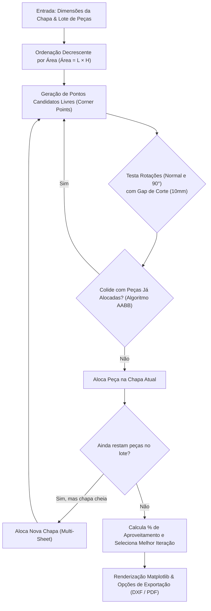

# 🧩 Rectangle Nesting — 2D Sheet Metal & Cutting Stock Optimizer

> **Software desktop para otimização de corte bidimensional (2D Nesting) de chapas industriais, com algoritmo heurístico de empacotamento, renderização gráfica em escala real e exportação direta para CAD (DXF) e PDF.**


-FF6F00?style=for-the-badge)
-CC0000?style=for-the-badge)


---

## 📌 Visão Geral & Problema de Negócio

No setor metalúrgico, caldeiraria e corte industrial (laser, plasma, oxicorte e serra), a matéria-prima (chapas de aço) representa grande parte dos custos produtivos. O arranjo manual de peças invariavelmente resulta em sobras excessivas (*scrap*) e desperdício de tempo operacional.

O **Rectangle Nesting** resolve o clássico problema computacional de **Corte e Empacotamento Bidimensional (*2D Cutting Stock / Strip Packing Problem - NP-Hard*)**. A aplicação distribui automaticamente conjuntos de peças retangulares sobre uma ou múltiplas chapas padronizadas, maximizando o aproveitamento superficial (%) e gerando arquivos prontos para alimentação direta de máquinas CNC e emissão de ordens de produção.

---

## 🚀 Destaques de Engenharia & Tecnologias

Diferente de sistemas convencionais, este projeto envolve **geometria computacional**, **otimização matemática combinatória** e **interoperabilidade industrial**:

| Camada / Tecnologia | O que faz no projeto | Competência Técnica Demonstrada |
| :--- | :--- | :--- |
| **Python 3** | Núcleo do motor de cálculo | Lógica de programação avançada, manipulação vetorial e tipagem |
| **Motor Heurístico de Nesting** | Algoritmo *Best-Fit Decreasing* com pontos candidatos cartesianos | Resolução de problemas NP-Difíceis, heurísticas de empacotamento e busca combinatória |
| **Geometria Computacional** | Algoritmo AABB (*Axis-Aligned Bounding Box*) para detecção de colisão | Testes de interseção geométrica rápida, rotação ortogonal 90° e cálculo de *kerf/gap* |
| **CAD / CAM Interoperability (`ezdxf`)** | Geração e exportação vetorial no padrão DXF (*Drawing Exchange Format*) | Integração com softwares CAD (AutoCAD, SolidWorks) e máquinas de corte CNC |
| **Geração de Relatórios (`reportlab`)** | Renderização vetorial e diagramação de relatórios industriais em PDF | Geração dinâmica de documentos para chão de fábrica em padrão A4 com escalas dimensionais |
| **Visualização Científica (`matplotlib`)** | Plotagem técnica interativa e cálculo de taxa de aproveitamento superficial (%) | Renderização gráfica customizada integrada via backend `TkAgg` em escala 1:1 |
| **GUI Desktop (`tkinter`)** | Interface gráfica intuitiva para entrada dimensional de chapas e lotes | Desenvolvimento desktop responsivo, tratamento de eventos e validação de entradas |
| **Empacotamento Standalone (`pyinstaller`)** | Compilação de binário executável nativo Windows (`.exe`) | Distribuição de software em ambientes fabris sem necessidade de interpretador Python |

---

## 🧠 Arquitetura do Motor de Nesting

O núcleo algorítmico do projeto opera através de uma abordagem estocástica com heurísticas de posicionamento:



### Detalhes Técnicos do Algoritmo:
1. **Heurística de Pontos Candidatos:** Em vez de força bruta em grade contínua, novos itens são testados estritamente nos vértices `(x + w, y)` e `(x, y + h)` das peças já fixadas, reduzindo a complexidade de busca.
2. **Controle de Kerf / Folga Industrial:** Parâmetro `GAP` configurável para compensar a sangria da tocha de corte (laser/plasma) e garantir integridade física das peças.
3. **Multi-Chapas (*Multi-Sheet*):** Gerenciamento dinâmico de produção contínua, alocando chapas adicionais sequencialmente até zerar a demanda de peças.

---

## 💡 Funcionalidades Principais

- 📐 **Setup Flexível de Chapas e Peças:** Configuração milimétrica de chapas brutas (ex: 6000 x 2500 mm) e múltiplos lotes de peças com quantidades variadas.
- 🔄 **Otimização com Rotação Automática:** Teste automático de rotação ortogonal (0° e 90°) para encontrar a orientação de menor desperdício.
- 📊 **Cálculo de Eficiência em Tempo Real:** Exibição da taxa de aproveitamento de área útil (%) e total de chapas utilizadas.
- 📄 **Exportação para DXF (AutoCAD/CNC):** Arquivos vetoriais com polilinhas fechadas prontos para carregamento em máquinas de corte a laser, plasma e oxicorte.
- 📑 **Exportação de Relatórios em PDF:** Pranchas dimensionadas individualizadas por chapa para controle de qualidade e ordens de produção.

---

## 📂 Estrutura do Repositório

```plaintext
Rectangle-Nesting/
├── Nesting.py           # Código-fonte principal (GUI Tkinter, Motor Heurístico e Exportadores)
├── Nesting.spec         # Configuração de build para compilação via PyInstaller
├── requirements.txt     # Dependências externas do ecossistema Python
├── .gitignore           # Filtro para ignorar artefatos de build (.exe), cache e IDEs
└── README.md            # Documentação técnica de engenharia
```

---

## 🛠️ Como Executar o Projeto

### Pré-requisitos
- **Python 3.10** ou superior
- Sistema Operacional: Windows, Linux ou macOS

### 1. Clonar o repositório
```bash
git clone https://github.com/meloericng/Rectangle-Nesting.git
cd Rectangle-Nesting
```

### 2. Criar e ativar o ambiente virtual
```bash
# Windows
python -m venv .venv
.venv\Scripts\activate

# Linux / MacOS
python3 -m venv .venv
source .venv/bin/activate
```

### 3. Instalar as dependências
```bash
pip install -r requirements.txt
```

### 4. Executar a aplicação
```bash
python Nesting.py
```

---

## 🖥️ Como Gerar o Executável Standalone (.exe)

Para gerar uma nova versão compilada para usuários finais que não possuem Python instalado:

```bash
pip install pyinstaller
pyinstaller Nesting.spec
```
O executável otimizado estará disponível no diretório `dist/Nesting.exe`.

---

## 🗺️ Roadmap de Evoluções Técnicas

- [ ] **Algoritmos Metaheurísticos:** Implementação de Algoritmos Genéticos (GA) ou *Simulated Annealing* para refinamento contínuo das soluções.
- [ ] **Nesting de Geometrias Irregulares:** Suporte a polígonos arbitrários via cálculo de *No-Fit Polygon (NFP)*.
- [ ] **Cálculo de Custos e Orçamentos:** Inserção do preço por kg do aço e custo do metro linear cortado para precificação automática de lotes.
- [ ] **Modernização da UI:** Migração opcional da interface para **CustomTkinter** (Dark Mode moderno) ou interface web com **FastAPI + Vue/React**.

---

## 👨‍💻 Autor

Desenvolvido por **Eric Melo**.

- 💼 **LinkedIn:** [linkedin.com/in/meloeric](https://www.linkedin.com/in/meloeric)
- 🐙 **GitHub:** [github.com/meloericng](https://github.com/meloericng)
- ✉️ **E-mail:** meloericng@gmail.com

---

_Projeto desenvolvido com foco em geometria computacional, otimização de recursos e engenharia de software aplicada à indústria metal-mecânica._
